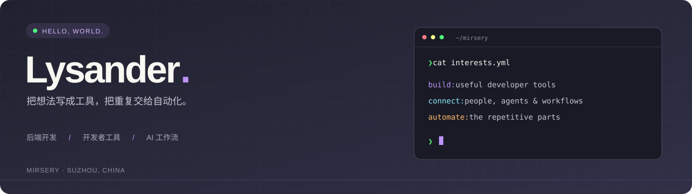

 <a href="https://mirsery.github.io">个人博客</a> · <a href="https://github.com/mirsery?tab=repositories">全部项目</a> · <a href="mailto:shuang.li@alpha-ess.com">联系我</a> 

关于我
你好，我是 Lysander / mirsery，来自苏州。
关注后端开发、实时通信与开发者工具，也在探索 AI 编程和飞书工作流。喜欢把日常遇到的问题，变成用起来顺手的小工具。
项目精选
<table> <tr> <td width="50%" valign="top"> <h3><a href="https://github.com/mirsery/lark-coding-agent-bridge">飞书 × 编程智能体</a></h3> 
基于上游项目持续迭代的个人 fork，将飞书消息连接到本地 Claude Code / Codex，支持流式卡片和独立会话。
 
<code>TypeScript</code> <code>飞书</code> <code>AI 工作流</code>
 </td> <td width="50%" valign="top"> <h3><a href="https://github.com/mirsery/easy-debug">easy-debug</a></h3> 
开箱即用的 WebSocket 工具，让连接和消息调试更方便。
 
<code>Java</code> <code>WebSocket</code> <code>调试工具</code>
 </td> </tr> <tr> <td width="50%" valign="top"> <h3><a href="https://mirsery.github.io">学习与折腾记录</a></h3> 
每天进步一点点，记录技术学习与实践。
 
<code>博客</code> <code>笔记</code> <code>持续学习</code>
 </td> <td width="50%" valign="top"> <h3><a href="https://github.com/mirsery/claude-dracula-theme">Dracula 主题</a></h3> 
个人主题项目，以及 SnippetsLab、CodeRunner 的 Dracula 配色探索。
 
<code>Dracula</code> <code>开发体验</code> <code>主题</code>
 </td> </tr> </table>
技术与方向
方向
技术
后端与通信
Java · Python · WebSocket
前端与工具
TypeScript · JavaScript · HTML / CSS
数据与工作流
MySQL · 飞书集成 · AI 编程

最近在折腾
飞书与本地编程智能体之间的协作体验。
把重复操作沉淀成可复用的工具和工作流。
让常用开发工具更顺手，也更好看。

 
GitHub 数据

贡献记录见主页下方的 GitHub 原生贡献图。
 
<a href="https://github.com/mirsery?tab=repositories">浏览项目</a> · <a href="https://github.com/mirsery?tab=stars">我的收藏</a>
 

保持好奇，持续构建。 · <a href="https://mirsery.github.io">mirsery.github.io</a>

