<picture>
  <source media="(prefers-color-scheme: dark)" srcset="./assets/banner-dark.svg">
  
</picture>

  <a href="https://mirsery.github.io">个人博客</a> ·
  <a href="https://github.com/mirsery?tab=repositories">全部项目</a> ·
  <a href="mailto:shuang.li@alpha-ess.com">联系我</a>

## 关于我

你好，我是 **Lysander / mirsery**，来自苏州。

关注后端开发、实时通信与开发者工具；最近在写 macOS / iOS 应用，也在探索 AI 编程和飞书工作流。喜欢把日常遇到的问题，变成用起来顺手的小工具。

## 项目精选

<table>
  <tr>
    <td width="50%" valign="top">
      <h3><a href="https://github.com/mirsery/GlossType">GlossType</a></h3>
      
macOS 15+ 英文输入法：候选词带中文释义，候选窗实时翻译正在写的句子，还会联想下一个词和短语。全部离线运行。

      
<code>Swift</code> <code>InputMethodKit</code> <code>macOS</code>

    </td>
    <td width="50%" valign="top">
      <h3><a href="https://github.com/mirsery/wristlab">Wristlab</a></h3>
      
本地优先的 iPhone + Apple Watch 健康趋势实验室：训练准备度、生理压力、身体电量与睡眠分析。没有后端，数据只在设备上处理。

      
<code>SwiftUI</code> <code>HealthKit</code> <code>watchOS</code>

    </td>
  </tr>
  <tr>
    <td width="50%" valign="top">
      <h3><a href="https://github.com/mirsery/lark-coding-agent-bridge">飞书 × 编程智能体</a></h3>
      
在飞书里直接使用本机的 Claude Code / Codex：流式卡片实时显示进度，每个会话独立续接，额度用完后自动续跑。

      
<code>TypeScript</code> <code>飞书</code> <code>AI Agent</code>

    </td>
    <td width="50%" valign="top">
      <h3><a href="https://github.com/mirsery/claude-dracula-theme">Claude Code Dracula 主题</a></h3>
      
为 Claude Code 命令行准备的 Dracula 配色，颜色全部取自官方色板；另有 <a href="https://github.com/mirsery/snippetsLab-draculatheme">SnippetsLab</a>、<a href="https://github.com/mirsery/coderRunner-draculatheme">CodeRunner</a> 版本。

      
<code>Claude Code</code> <code>Dracula</code> <code>主题</code>

    </td>
  </tr>
  <tr>
    <td width="50%" valign="top">
      <h3><a href="https://github.com/mirsery/easy-debug">WebSocket 调试工具</a></h3>
      
开箱即用的 WebSocket 桌面调试工具，有 Java 版 <a href="https://github.com/mirsery/easy-debug">easy-debug</a> 和 Electron 版 <a href="https://github.com/mirsery/websocket-tool">websocket-tool</a>。

      
<code>Java</code> <code>Electron</code> <code>WebSocket</code>

    </td>
    <td width="50%" valign="top">
      <h3><a href="https://mirsery.github.io">学习与折腾记录</a></h3>
      
每天进步一点点：Java、数据库、Docker、算法和开发工具的学习笔记。

      
<code>Hexo</code> <code>博客</code> <code>持续学习</code>

    </td>
  </tr>
</table>

## 最近更新

<!-- recent:start -->
- `2026-10-24` **[wristlab](https://github.com/mirsery/wristlab)** · Swift
- `2026-10-24` **[GlossType](https://github.com/mirsery/GlossType)** · Swift
- `2026-10-23` **[lark-coding-agent-bridge](https://github.com/mirsery/lark-coding-agent-bridge)** · TypeScript
- `2026-10-15` **[mirsery.github.io](https://github.com/mirsery/mirsery.github.io)** · SCSS
- `2026-10-05` **[claude-dracula-theme](https://github.com/mirsery/claude-dracula-theme)**
<!-- recent:end -->

## 技术与方向

| 方向 | 技术 |
| :--- | :--- |
| 后端与通信 | `Java` · `Spring Boot` · `Netty` · `WebSocket` · `Python` · `MySQL` |
| Apple 平台 | `Swift` · `SwiftUI` · `HealthKit` · `InputMethodKit` |
| 前端与桌面 | `TypeScript` · `Vue` · `Electron` |
| AI 与工作流 | `Claude Code` · `Codex` · `飞书开放平台` |

---

保持好奇，持续构建。

